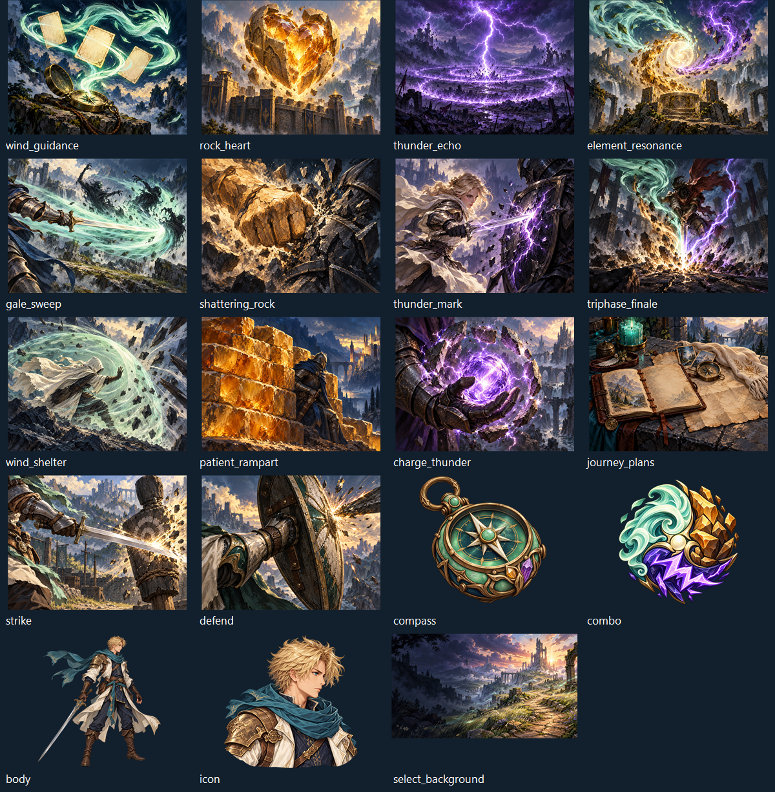

# TASK-009 正式图片生成记录

2026-10-20。按用户确认替换全部本项目正在使用的几何占位图片，共19项。使用imagegen技能的默认内置image_gen模式，没有CLI/API密钥调用，也没有外部作品参考图。头像使用本轮生成的body.png作为唯一身份参考。原始PNG直接复制进项目，没有重新编码或裁切；Godot场景按原生UI和战斗尺寸缩放。



文件路径、尺寸、透明背景、大小及SHA256见[TASK-009-assets.json](TASK-009-assets.json)。运行时资源位于`src/Sts2Mod/Sts2Mod/art`和`character`。联系表由`New-Task009ArtCatalog.ps1`只读组合用于QA，不替代任何运行时图片。

旧SVG保留历史来源，但C#及TSCN已不再引用。原有六牌和派蒙正式PNG不变。原生共用卡框、音效、能量动画、营地/商人和多人手势仍通过游戏资源运行时引用；不复制原生素材，不声称完成新的骨骼动画、配音或多人演出。

## 卡牌完整提示词

### wind_guidance.png

```text
Use case: stylized-concept. Production landscape card illustration for a fantasy deckbuilding roguelike mod, no card frame, no UI, no letters, no numbers, no watermark. Original stylized hand-painted storybook fantasy, chunky readable shapes, confident dry-brush edges, textured deep navy background, warm parchment highlights, restrained painterly shading and dramatic lighting. Wide 4:3 composition, must read cropped to 500:380 card portrait. Clear central action and strong silhouette; key subjects inside central 75%. Finished painted illustration, not a geometric icon. Asset: Wind Guidance. A luminous mint wind spirit shaped like a flowing ribbon guides three blank parchment cards in an elegant orbit above an open travel compass. Sweeping motion leads the eye forward. Jade and ivory against midnight blue. A persistent blessing of wind, no human faces.
```

### rock_heart.png

```text
Use case: stylized-concept. Production landscape card art for a fantasy deckbuilding roguelike. Original polished hand-painted storybook fantasy, bold readable silhouettes, textured dry-brush paint, deep navy shadows and ivory highlights, restrained luminous elemental effects. Wide 4:3 composition, readable cropped to 500:380. Keep focal subjects inside central 75%. Full finished illustration, no frame, no UI, no letters or numbers, no logo or watermark, not geometric placeholder art. A massive cracked amber gemstone heart nested within protective ochre stone plates, suspended over an ancient stone rampart; warm golden light in its core, dust and chips, enduring defensive blessing.
```

### thunder_echo.png

```text
Use case: stylized-concept. Production landscape card art for a fantasy deckbuilding roguelike. Original polished hand-painted storybook fantasy, bold readable silhouettes, textured dry-brush paint, deep navy shadows and ivory highlights, restrained luminous elemental effects. Wide 4:3 composition, readable cropped to 500:380. Keep focal subjects inside central 75%. Full finished illustration, no frame, no UI, no letters or numbers, no logo or watermark, not geometric placeholder art. Three receding thunder rings ripple from a violet-white lightning strike across a dark ruined battlefield, striking two distant stone silhouettes. Strong central lightning fork, amethyst palette, magical repeating echo.
```

### element_resonance.png

```text
Use case: stylized-concept. Production landscape card art for a fantasy deckbuilding roguelike. Original polished hand-painted storybook fantasy, bold readable silhouettes, textured dry-brush paint, deep navy shadows and ivory highlights, restrained luminous elemental effects. Wide 4:3 composition, readable cropped to 500:380. Keep focal subjects inside central 75%. Full finished illustration, no frame, no UI, no letters or numbers, no logo or watermark, not geometric placeholder art. Three flowing forces mint wind, golden rock shards, and violet lightning converge around one glowing ivory orb above a weathered altar. Balanced triangular spiral, a sustained three-element resonance.
```

### gale_sweep.png

```text
Use case: stylized-concept. Production landscape card art for a fantasy deckbuilding roguelike. Original polished hand-painted storybook fantasy, bold readable silhouettes, textured dry-brush paint, deep navy shadows and ivory highlights, restrained luminous elemental effects. Wide 4:3 composition, readable cropped to 500:380. Keep focal subjects inside central 75%. Full finished illustration, no frame, no UI, no letters or numbers, no logo or watermark, not geometric placeholder art. A cropped armored gauntlet sweeps a sword horizontally, launching a broad mint wind crescent across a group of three shadow creatures. Dynamic panoramic sweeping action, teal gusts and ivory blade.
```

### shattering_rock.png

```text
Use case: stylized-concept. Production landscape card art for a fantasy deckbuilding roguelike. Original polished hand-painted storybook fantasy, bold readable silhouettes, textured dry-brush paint, deep navy shadows and ivory highlights, restrained luminous elemental effects. Wide 4:3 composition, readable cropped to 500:380. Keep focal subjects inside central 75%. Full finished illustration, no frame, no UI, no letters or numbers, no logo or watermark, not geometric placeholder art. A huge ochre stone-clad fist smashing a dark stone armor plate into flying angular fragments. Tight powerful impact, weight and momentum, warm amber highlights, navy darkness.
```

### thunder_mark.png

```text
Use case: stylized-concept. Production landscape card art for a fantasy deckbuilding roguelike. Original polished hand-painted storybook fantasy, bold readable silhouettes, textured dry-brush paint, deep navy shadows and ivory highlights, restrained luminous elemental effects. Wide 4:3 composition, readable cropped to 500:380. Keep focal subjects inside central 75%. Full finished illustration, no frame, no UI, no letters or numbers, no logo or watermark, not geometric placeholder art. A narrow silver blade traces one jagged violet lightning scar into a dark armored shield. A glowing exposed crack marks a vulnerable target, energetic single strike, amethyst and ivory.
```

### triphase_finale.png

```text
Use case: stylized-concept. Production landscape card art for a fantasy deckbuilding roguelike. Original polished hand-painted storybook fantasy, bold readable silhouettes, textured dry-brush paint, deep navy shadows and ivory highlights, restrained luminous elemental effects. Wide 4:3 composition, readable cropped to 500:380. Keep focal subjects inside central 75%. Full finished illustration, no frame, no UI, no letters or numbers, no logo or watermark, not geometric placeholder art. One sword strikes downward carrying three converging trails of mint wind, ochre stone fragments and violet lightning. A single brilliant finishing blow in a dark ruined arena, dramatic triangular focal point.
```

### wind_shelter.png

```text
Use case: stylized-concept. Production landscape card art for a fantasy deckbuilding roguelike. Original polished hand-painted storybook fantasy, bold readable silhouettes, textured dry-brush paint, deep navy shadows and ivory highlights, restrained luminous elemental effects. Wide 4:3 composition, readable cropped to 500:380. Keep focal subjects inside central 75%. Full finished illustration, no frame, no UI, no letters or numbers, no logo or watermark, not geometric placeholder art. A cropped traveler bracing behind a curved translucent mint wind barrier as incoming sharp debris is diverted around them. Clear defensive dome, fluttering ivory cloak, no visible recognizable face.
```

### patient_rampart.png

```text
Use case: stylized-concept. Production landscape card art for a fantasy deckbuilding roguelike. Original polished hand-painted storybook fantasy, bold readable silhouettes, textured dry-brush paint, deep navy shadows and ivory highlights, restrained luminous elemental effects. Wide 4:3 composition, readable cropped to 500:380. Keep focal subjects inside central 75%. Full finished illustration, no frame, no UI, no letters or numbers, no logo or watermark, not geometric placeholder art. An ancient layered amber stone wall shielding a sheathed sword held ready behind it, a quiet patient guard stance. Weighty ochre slabs, warm ivory edge light, deep navy atmosphere.
```

### charge_thunder.png

```text
Use case: stylized-concept. Production landscape card art for a fantasy deckbuilding roguelike. Original polished hand-painted storybook fantasy, bold readable silhouettes, textured dry-brush paint, deep navy shadows and ivory highlights, restrained luminous elemental effects. Wide 4:3 composition, readable cropped to 500:380. Keep focal subjects inside central 75%. Full finished illustration, no frame, no UI, no letters or numbers, no logo or watermark, not geometric placeholder art. A cropped armored hand cups a violet lightning orb while a protective ring of stone blocks deflects sparks, stored energy visibly gathering for the next turn. Amethyst glow, ivory sparks.
```

### journey_plans.png

```text
Use case: stylized-concept. Production landscape card art for a fantasy deckbuilding roguelike. Original polished hand-painted storybook fantasy, bold readable silhouettes, textured dry-brush paint, deep navy shadows and ivory highlights, restrained luminous elemental effects. Wide 4:3 composition, readable cropped to 500:380. Keep focal subjects inside central 75%. Full finished illustration, no frame, no UI, no letters or numbers, no logo or watermark, not geometric placeholder art. An open leather travel journal and blank parchment map on a stone table, two small keepsake cards tucked under a compass and a folded ivory scarf. Thoughtful preparations, turquoise candle glow, no readable marks.
```

### strike.png

```text
Use case: stylized-concept. Production landscape card art for a fantasy deckbuilding roguelike. Original polished hand-painted storybook fantasy, bold readable silhouettes, textured dry-brush paint, deep navy shadows and ivory highlights, restrained luminous elemental effects. Wide 4:3 composition, readable cropped to 500:380. Keep focal subjects inside central 75%. Full finished illustration, no frame, no UI, no letters or numbers, no logo or watermark, not geometric placeholder art. A cropped armored forearm delivering a clean diagonal silver sword slash toward a dark stone practice target, warm ivory impact flash, original adventurer equipment with subtle mint scarf.
```

### defend.png

```text
Use case: stylized-concept. Production landscape card art for a fantasy deckbuilding roguelike. Original polished hand-painted storybook fantasy, bold readable silhouettes, textured dry-brush paint, deep navy shadows and ivory highlights, restrained luminous elemental effects. Wide 4:3 composition, readable cropped to 500:380. Keep focal subjects inside central 75%. Full finished illustration, no frame, no UI, no letters or numbers, no logo or watermark, not geometric placeholder art. A cropped armored forearm firmly raising a weathered oval metal and leather shield to stop a sharp impact, broad protective silhouette, ivory and jade trim, warm amber sparks.
```

## 图标与角色提示词

以下四项共同前缀：

```text
Use case: stylized-concept. Finished original hand-painted storybook fantasy game asset, textured brushwork, strong readable silhouette, ivory edge highlights and deep midnight blue shading. No text, no UI, no watermark, no border, not geometric placeholder art. 
```

### compass.png

```text
A single ornate travel compass relic, jade mint enamel, worn bronze ring, ivory star-shaped needle, a tiny ochre crystal and a violet crystal in the housing. Three-quarter front view, centered entire object with generous transparent padding, no background, genuinely transparent background. Clear at 64 pixels.
```

### combo.png

```text
A single magical medallion icon: three interlocking flowing forces, a mint wind curl, a faceted ochre rock shard, and a jagged amethyst lightning bolt, united around a small ivory center. Polished painted game buff icon, centered complete silhouette, no background, genuinely transparent background, readable at 48 pixels.
```

### body.png

```text
Full-body male wandering elemental swordsman for a 2D side-view roguelike battle sprite, facing RIGHT in three-quarter profile, calm alert grounded stance. Original youthful adult with short tousled sandy blond hair, teal scarf flowing behind him, layered ivory traveling coat, dark navy tunic and trousers, bronze shoulder armor, brown leather boots and belts. One slim silver sword held downward in right hand, left hand ready. Entire figure and feet fully visible, generous transparent padding, genuinely transparent background, no floor or scenery or drop shadow. Painterly readable anatomy, confident shapes, no famous character costume.
```

### select_background.png

```text
Wide 16:9 finished fantasy character-selection background landscape ONLY, no character. An ancient ochre stone path winds from foreground into a distant ruined spire, mint wind ribbons sweeping across tall meadow grass, distant violet storm clouds pierced by warm sunrise. Left third dark and calm for game UI, visual interest centered in the right two thirds, painterly storybook landscape, broad readable shapes, dramatic atmospheric depth.
```

### icon.png（编辑模式：本轮body.png为身份参考，透明背景）

```text
Use case: identity-preserve. Input image is the exact character identity reference. Create a finished square game character avatar portrait of this SAME male traveler: identical tousled blond hair, face, teal scarf, ivory coat and bronze shoulder armor. Frame the head and shoulders centered, clear large readable face, facing slightly RIGHT, calm determined expression. Match the input painterly fantasy rendering and colors. No redesign, no sword, no full body, no border, no letters, no watermark. Genuinely transparent background, generous padding at the hair and shoulders, readable at 64px.
```

生成与静态图片检查不等同于实机图形验收：本轮继续使用后台无GUI游戏测试，不打开用户游戏窗口。透明图四项已检查PNG透明角；图片小尺寸辨识、场景遮挡和选人排版仍待用户在游戏内最终确认。图片为生成式插图，非官方作品素材或游戏截图，后续发行时应按平台要求披露。
