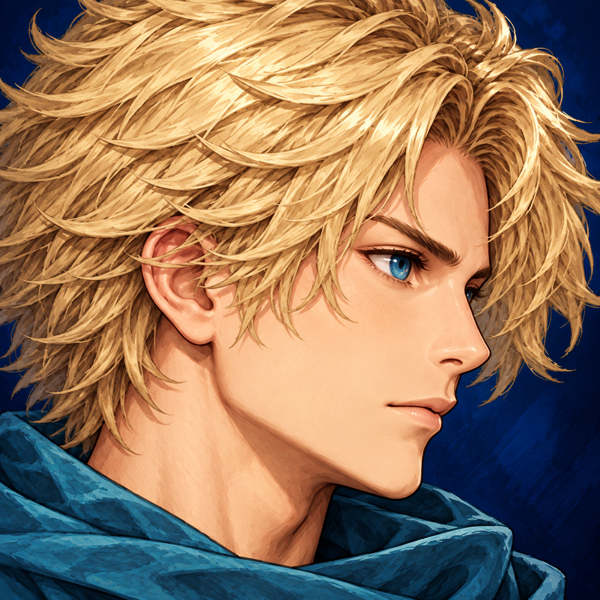

# TASK-010：左上角面部特写

2026-10-21，按用户附图红箭头要求修改左上角头像。使用imagegen技能、内置image_gen编辑模式；唯一身份参考为本项目TASK-009生成的character/icon.png，没有使用截图中的场景或玩家进度作为美术素材，没有CLI/API密钥调用。

最终文件：`src/Sts2Mod/Sts2Mod/character/head_icon.png`，1254×1254，不透明深蓝背景。SHA256：`404B2AF51B6793C8B19604BB852CF9C5D4A47760FD59F8D6751274740C3F3BAF`。生成PNG直接复制入项目，没有再编码或裁切；Godot图标场景缩放到原生64px。



接线：`Character.Icon`对应`character/icon.tscn`改为head_icon.png；CustomIconTexturePath/Outline也同步。选人/地图icon.png与战斗body.png保持，没有误改整个选人界面或战斗角色。头像原图已检查身份、构图和无水印，原生左上角场景加载另有无GUI断言；实际画面裁切/边框仍需人工确认。

完整提示词（参考图角色身份，不是截图编辑目标）：

```text
Use case: identity-preserve. Edit the provided portrait into a square FACE CLOSE-UP UI avatar for the very small top-left health panel of a fantasy game. Preserve EXACT same male face, short blond hair, blue eye, painterly rendering and teal scarf identity. Zoom in substantially: face and hair fill 85-90% of the entire square; only a tiny sliver of scarf at bottom, NO shoulders, NO breastplate, NO torso. Face centered in three-quarter view toward right, crop some outer hair naturally to avoid empty margins, keep the full eye/nose/chin visible. Deep dark blue painted background filling all pixels, opaque background, no transparent padding. This is a standalone texture, no frame, no UI, no writing, no watermark. Improve readability at 64x64 through clear face silhouette and broad clean light/shadow shapes.
```
